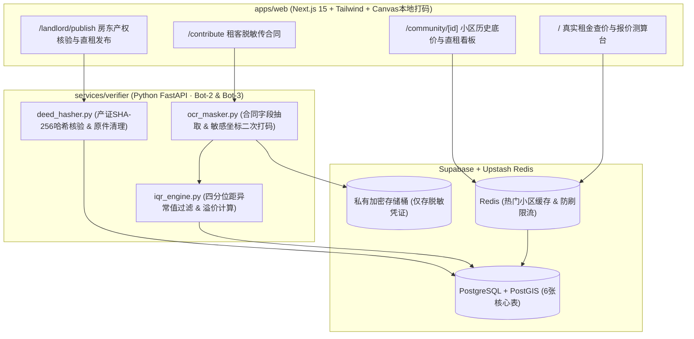

# 透明租 (Transparent Rent) · 全国真实租金互助与房东直租平台 MVP

> 拒绝中介信息差与按房租比例抽佣：靠租客脱敏合同共建真实成交底价库，用固定 ¥199 技术服务费打通房东直租闭环。

## 核心特性
- **零爬虫合规验真**：不抓取外部中介平台，租客本地 Canvas 涂抹打码后上传合同/流水，结合 IQR 统计学离群值过滤建立真实底价库。
- **报价照妖镜**：租客输入外部平台报价，实时测算相对同小区真实成交中位数的溢价率与砍价区间。
- **房东直租一口价**：不动产权证单向 SHA-256 哈希核验（核验后销毁原件），不按租金抽佣，成交仅收固定 ¥199 电子合同与存证技术服务费。

## 系统与 Devin Bot 分工架构

## 推进路线图

- [x] 完成 Monorepo 架构设计、Prisma 数据库 Schema 与 IQR 验真引擎原型
- [ ] Phase 1 (Bot-1): 初始化 Next.js 15 + Supabase 前端工程，上线 4 个核心页面
- [ ] Phase 2 (Bot-2): 接入 IQR 异常报价拦截脚本与单条报价溢价测算接口
- [ ] Phase 3 (Bot-3): 接入 OCR 凭证自动脱敏管道与 199 元固定服务费电子签约闭环
